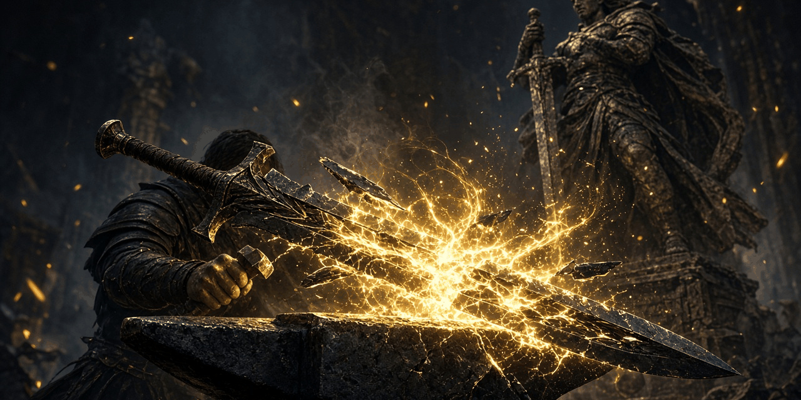

# Champion's Reforge

*Adrianne Avenicci has her grandfather's design for a champion's harness. Somebody stole the notes.*

A masterwork-smithing quest with a vanilla smith. **Adrianne Avenicci** at Warmaiden's in Whiterun has her grandfather's design for a champion's harness, but the forging notes were stolen. Choose the side the harness is forged for, recover the notes, bring the steel, and wear a harness whose temper grows with every matching champion's piece. If you own the Anniversary Edition **Civil War Champions** Creation, its armor of your chosen side counts too.

**Status: v0.1.1, early beta.** It passes every automated check in the build (Papyrus compile, plugin and dialogue validation, byte-exact round trip, voice file and SEQ checks, FOMOD schema, the series compatibility check) but has not been playtested in-game yet. Expect rough edges and please report what you find. See [docs/TESTING.md](docs/TESTING.md).

- Game: Skyrim Special Edition / Anniversary Edition 1.6.x (also fine on 1.5.97). Works on Windows and on Linux through Proton.
- Requirements: none beyond the base game. No SKSE, no SkyUI, no DLC, no Creation Club content required (Civil War Champions is optional and only detected at runtime).
- Plugin: `ChampionsReforge.esp`, ESL-flagged, Skyrim.esm is the only master. **No vanilla records edited** (zero overrides).
- Part of the synthalorian series and compatible with all of it: [Blackshield Company](https://github.com/synthalorian/blackshield-company), [Bounties of Oblivion](https://github.com/synthalorian/bounties-of-oblivion), [Contract Hunter](https://github.com/synthalorian/contract-hunter), [Steel Oath](https://github.com/synthalorian/steel-oath), [Ember Smithing](https://github.com/synthalorian/ember-smithing), [The Gray-Mane Debt](https://github.com/synthalorian/the-gray-mane-debt), [Blackshield Codex](https://github.com/synthalorian/blackshield-codex), [War Banners](https://github.com/synthalorian/war-banners), [Roadwarden](https://github.com/synthalorian/roadwarden), [Sellsword Roster](https://github.com/synthalorian/sellsword-roster), [The Turncoat Contract](https://github.com/synthalorian/the-turncoat-contract), [The Ledger of Ash](https://github.com/synthalorian/the-ledger-of-ash), [Oathbreaker's Price](https://github.com/synthalorian/oathbreakers-price), [Champion's Reforge](https://github.com/synthalorian/champions-reforge), [The Barrow-Iron Pact](https://github.com/synthalorian/barrow-iron-pact). Own prefix (`CRF_`), records, globals, scripts and files; checked by loading all 15 plugins together (see [tools/modkit](tools/modkit/README.md)).

## The quest

1. **"Any commissions worth taking?"** Ask Adrianne (level 10+). Choose **the Legion (dragon crest)** or **the Stormcloaks (bear crest)**.
2. **The forging notes** are with the Ash-Hand Forgebreaker at a military fort in Whiterun, Falkreath, Haafingar, the Reach, the Pale or Hjaalmarch.
3. **The materials**: 4 steel ingots, 2 corundum ingots, 2 leather.
4. **Hand it all over**, wait a day, collect the **Champion's Harness of the Dragon** (health, fire resistance) or **of the Bear** (stamina, frost resistance), and the **Champion's Temper**.
5. **Masterwork (optional, any time later)**: bring 3 ebony ingots and a dragon bone. A day later: the **Masterwork Harness** and the **Champion's Masterwork Temper**.

| Choice | How | Reward |
|---|---|---|
| Legion commission | "Forge it for the Legion. Dragon crest." | Champion's Harness of the Dragon; with Civil War Champions, the **Imperial Dragon** set counts toward the temper |
| Stormcloak commission | "Forge it for the Stormcloaks. Bear crest." | Champion's Harness of the Bear; with Civil War Champions, the **Storm-Bear** set counts toward the temper |
| Masterwork | "About that masterwork tempering..." with 3 ebony ingots and a dragon bone | Masterwork Harness (higher rating, stronger enchantment) and the stronger temper |

## Items

- Champion's Harness of the Dragon / of the Bear, upgradeable to Masterwork
- Champion's Temper: +15 armor per matching piece worn (masterwork: +25 armor and +3% magic resistance per piece), up to 6 pieces
- Avenicci Forging Notes

## Series integration (optional, no masters)

When other mods of the series are installed, this one notices. Nothing here is a master and nothing is required: a script on the player looks each plugin up at runtime with `Game.GetFormFromFile` (vanilla Papyrus since 2012, no SKSE) on every game load, and when the plugin is missing the call returns None and that feature is skipped.

| Mod | Reads | Effect |
|---|---|---|
| Civil War Champions (Anniversary Edition, ccffbsse001-imperialdragon.esl) | Imperial Dragon armor/boots/gauntlets/helmet/shield (D69, D68, 84D, 848, 84A) and Storm-Bear armor/boots/gauntlets/helmet/shield (84C, 849, D6A, D6B, D6C), FormIDs from UESP | Every worn piece of the set matching your side counts toward the Champion's Temper: up to 6 pieces with the harness (Legion + full Imperial Dragon kit worn = +90 armor, masterwork +150 armor and +18% magic resistance). No CC record is edited, no CC asset is copied, and the CC plugin is **not** a master; without it, only the harness counts. |
| The Gray-Mane Debt | `GMD_State` | If you helped Eorlund, Adrianne has heard about it (different opening). |
| Ember Smithing | `EMB_HeatTemperedIronSword (presence check)` | Adrianne notices your ember-work (different opening). |

### Civil War Champions (Anniversary Edition)

The Anniversary Edition armor upgrade works without a hard master: `CRF_TemperScript` looks up the ten Civil War Champions armor pieces from `ccffbsse001-imperialdragon.esl` with `Game.GetFormFromFile` and counts the ones you wear that match your side. The bonus is an ability on you (Champion's Temper), so no CC record is overridden and no CC mesh or texture is copied or shipped. Without the Creation, only the harness counts. FormIDs: UESP, *Skyrim:Civil War Champions Items* (not checked against the .esl itself; see Known issues).

## Unvoiced dialogue

All 26 new lines are unvoiced, shown as subtitles, and each one ships with a silent voice file sized to its length, so subtitles stay on screen (same approach as The Gray-Mane Debt). Turn subtitles on. Fuz Ro D'oh is not needed and doesn't conflict.

## Install

Grab `ChampionsReforge-0.1.1.zip` from [Releases](https://github.com/synthalorian/champions-reforge/releases) (FOMOD installer).

- **Mod Organizer 2** or **Vortex**: install the zip and enable `ChampionsReforge.esp`.
- **Manual (Linux/Proton)**: copy everything inside `00 Core/` (plugin, `Scripts/`, `SEQ/`, `Sound/`) into `.../steamapps/common/Skyrim Special Edition/Data/` and add `*ChampionsReforge.esp` to `Plugins.txt` in the Proton prefix (`.../compatdata/489830/pfx/drive_c/users/steamuser/AppData/Local/Skyrim Special Edition/`).

Safe to add to an existing save. Finish the quest before uninstalling.

## Console tunables

```
set CRF_MinLevel to 10
```

## What got scaled down

- The Civil War Champions upgrade is a scripted ability on the player (armor/magic resistance per worn piece), not new upgraded copies of the CC armor: making real upgraded CC armor records would need the CC plugin as a hard master, and its meshes can't be redistributed. Adrianne does not hand out CC pieces; you get them through the Creation's own quest.
- The harness reuses the vanilla steel cuirass mesh.
- No forging animation or scene: Adrianne takes the materials and you come back a day later.

## Known issues and risks

- Not playtested in-game, including the Civil War Champions path: the CC FormIDs come from UESP and were not checked against the actual .esl (I have no copy). If one is wrong, that piece just doesn't count; the Papyrus log says so.
- If Civil War Champions is not installed, Papyrus logs one 'file not found' style warning from Game.GetFormFromFile on each load. That's harmless.
- Mods that change Adrianne's voice type move her lines away from the silent voice files (FemaleCommander, per UESP).
- Adrianne is used through a unique-actor alias; her record and dialogue are not edited. If she dies mid-commission the quest fails cleanly.

## Build from source

`./build.sh` on Linux builds the release zip: Papyrus is compiled with the open-source [papyrus-compiler](https://github.com/russo-2025/papyrus-compiler) against clean-room vanilla declaration stubs, the plugin is generated from C# with [Mutagen](https://github.com/Mutagen-Modding/Mutagen) (`src/plugin/ChampionsReforge.Generator`: `Mod.cs` holds this mod, `Kit.cs`/`Program.cs`/`Vanilla.cs` are shared by the third wave), the SEQ file and silent voice files are written next to it, and everything is validated. The zip is reproducible: a fresh clone rebuilds it byte for byte. `src/plugin/formids.json` pins every FormID; never edit or reuse entries.

Current build: 68 new records (FormIDs 800-843): Armor 4, Book 1, DialogBranch 5, DialogResponses 17, DialogTopic 8, FormList 1, GlobalFloat 8, MagicEffect 2, Message 3, Npc 1, ObjectEffect 4, Quest 2, Spell 12; 12 Papyrus scripts; 26 silent voice files; 1 SEQ entry.

## Support

Donations are optional. Nothing in the mod is gated on them.

- GitHub Sponsors: https://github.com/sponsors/synthalorian
- Ko-fi: https://ko-fi.com/synthalorian

## License

The repository's code and documentation are licensed under the [MIT License](LICENSE). Referenced Skyrim records and meshes remain Bethesda Softworks' property; no Bethesda assets are included.

## Credits

- Built with [Mutagen](https://github.com/Mutagen-Modding/Mutagen) and [russo-2025/papyrus-compiler](https://github.com/russo-2025/papyrus-compiler).
- Skyrim and every referenced vanilla record and mesh belong to Bethesda Softworks. This mod references them from Skyrim.esm and ships no Bethesda assets. Civil War Champions is a Creation by Borja "Borx25" Franco and Kris Takahashi; it is referenced at runtime only.

## Support

Donations are optional. Nothing in the mod is gated on them.

- GitHub Sponsors: https://github.com/sponsors/synthalorian
- Ko-fi: https://ko-fi.com/synthalorian

<p><br><sub>A <a href="https://github.com/Blackshield-Company">Blackshield Company</a> mod.</sub></p>
